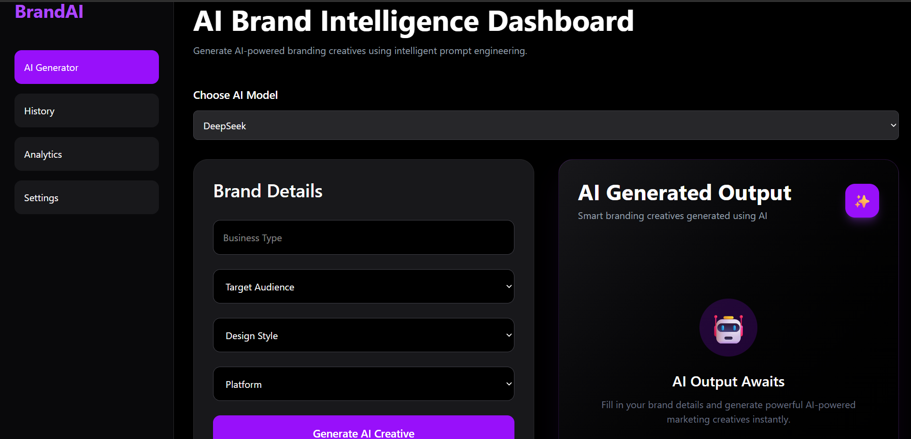
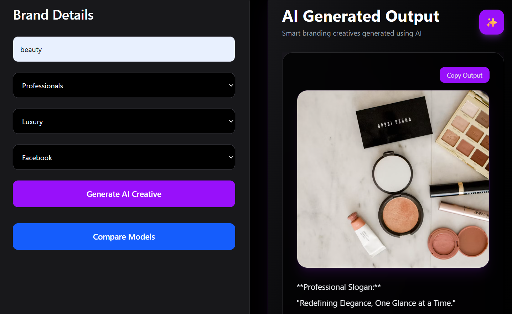
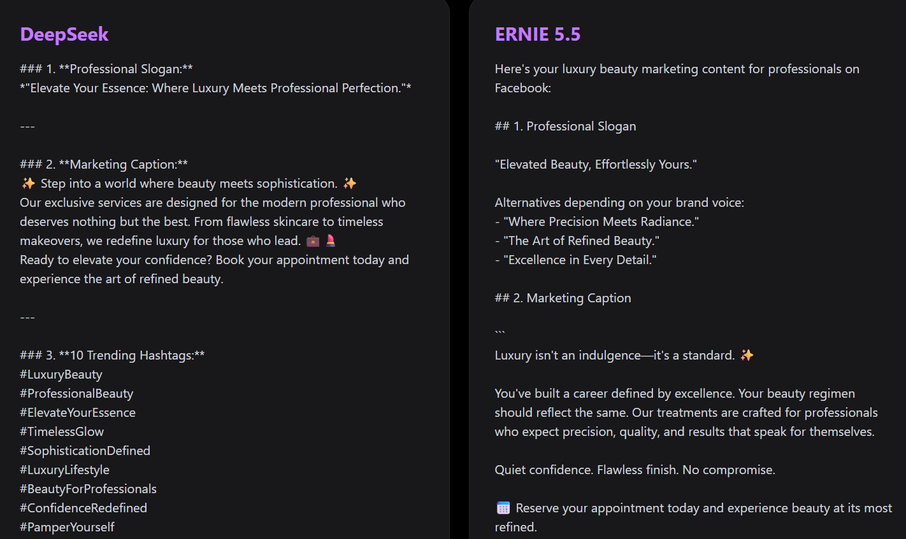
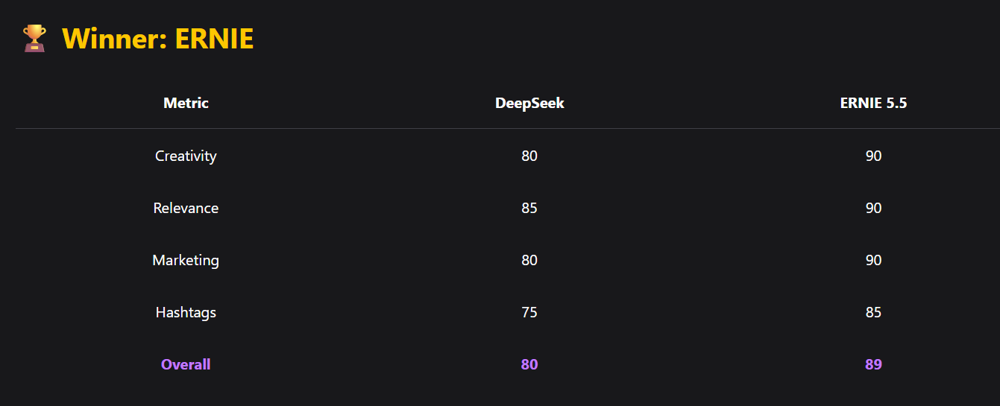

# BrandAI – AI Brand Intelligence Platform

BrandAI is an AI-powered web application that helps businesses generate creative branding and marketing content. It uses multiple Large Language Models (LLMs) to generate slogans, captions, and hashtags, and compares their outputs using an AI-based evaluation mechanism.

## 🚀 Features

- **AI Content Generation:** Generate professional slogans, marketing captions, and hashtags.
- **Multiple AI Models:** Integrates DeepSeek and Baidu ERNIE 5.5 Flash Preview through OpenRouter API.
- **AI Model Comparison:** Generates content using both models for the same business requirements.
- **AI-Based Evaluation:** Evaluates outputs based on creativity, brand relevance, marketing effectiveness, and hashtag quality.
- **Winner Selection:** Identifies the better-performing output based on AI-generated evaluation scores.
- **Business-Based Images:** Displays relevant images based on business categories.
- **Interactive Dashboard:** Provides a user-friendly interface for content generation and comparison.
- **Creative History:** Keeps track of generated branding content during the session.
- **PDF Export:** Allows users to export generated creative content as a PDF.
- **Dashboard Customization:** Includes dark and light appearance modes.

## 🛠️ Technology Stack

| Category | Technologies |
|---|---|
| Frontend | React.js, JavaScript |
| Build Tool | Vite |
| Styling | Tailwind CSS |
| Backend | Node.js, Express.js |
| AI Integration | OpenRouter API |
| AI Models | DeepSeek, Baidu ERNIE 5.5 Flash Preview |
| HTTP Requests | Axios, Fetch API |
| PDF Export | jsPDF |
| Development Tools | VS Code, Git, GitHub |

## 🏗️ System Architecture

1. User enters business details, target audience, design style, and social media platform.
2. React frontend sends the information to the Node.js and Express backend.
3. The backend communicates with DeepSeek and ERNIE through OpenRouter API.
4. Both AI models generate branding content independently.
5. DeepSeek acts as the AI Judge and evaluates both outputs.
6. The evaluation scores are displayed in the dashboard, along with the selected winner.

## 📸 Project Screenshots

### AI Branding Dashboard


### AI Generated Content


### AI Model Comparison and Evaluation


### AI Evaluation and Winner Selection


## ⚙️ Installation and Setup

### Prerequisites

- Node.js and npm
- Git
- OpenRouter API key

### 1. Clone the Repository

```bash
git clone https://github.com/reena2002-08/BrandAI.git
cd BrandAI
```

### 2. Setup the Backend

```bash
cd server
npm install
```

Create a `.env` file inside the `server` folder:

```env
OPENROUTER_API_KEY=your_openrouter_api_key
```

Start the backend:

```bash
npm start
```

The backend runs at:

`http://localhost:8000`

### 3. Setup the Frontend

Open a second terminal from the project root:

```bash
cd client
npm install
npm run dev
```

Open the local URL displayed by Vite, usually:

`http://localhost:5173`

## 🔐 Environment Variables

The backend requires the following environment variable:

| Variable | Description |
|---|---|
| OPENROUTER_API_KEY | API key used to access AI models through OpenRouter |

Never commit your `.env` file or expose your API key publicly.

## 🎯 Project Objective

The main objective of BrandAI is to simplify branding and marketing content creation through Generative AI. By integrating multiple AI models and evaluating their outputs, the platform helps users compare AI-generated content and identify suitable branding creatives.

## 👩‍💻 Author

**M Reena**

MCA | AI & Full Stack Development

- GitHub: https://github.com/reena2002-08
- LinkedIn: https://www.linkedin.com/in/reena-murari-2a911a2ba

---

*BrandAI – Transforming Business Ideas into Creative Brand Content with AI.*
